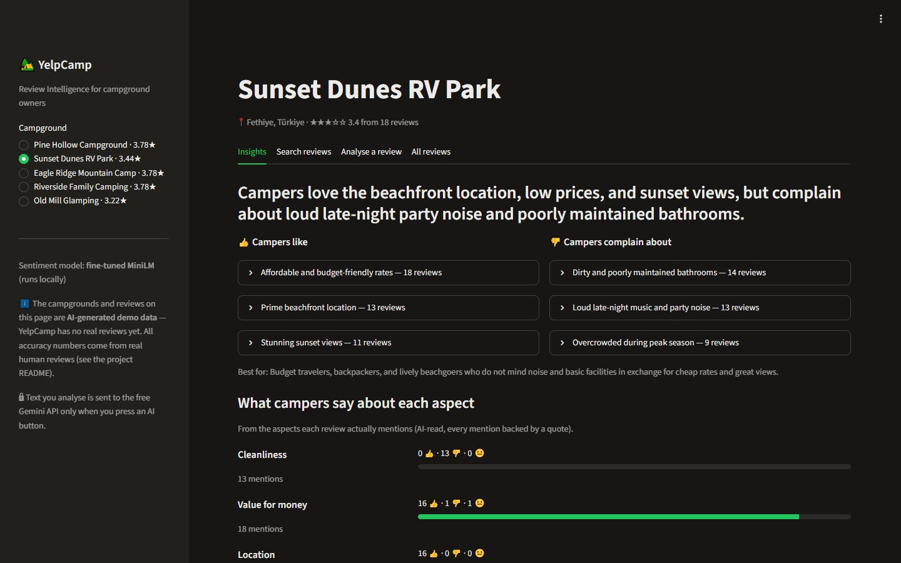

# YelpCamp Review Intelligence

An NLP service that tells campground owners what campers are really saying. For every review it finds the **overall sentiment** and the opinion on **five aspects** — cleanliness, value, location, sites & facilities, quiet & sleep. For every campground it writes a **summary of pros and cons that cites the reviews it came from**, lets owners **search reviews by meaning** ("is it quiet at night?") and **drafts polite replies** to reviews.

Built as the review layer for [YelpCamp](https://omar122211.github.io/profile/#work), my campground platform.



## The main question: which model should do the work?

I trained and compared four approaches on the same **real, human-written reviews never seen in training**:

RESULTS_TABLE

Takeaways:
TAKEAWAYS

## How it works

```
review text
  ├─ local, instant, free ──────────────────────────────────────────────────────────────┐
  │   fine-tuned MiniLM (22M params) ─────────► sentiment + confidence                  │
  │   TF-IDF + logistic regression × 5 ───────► aspect estimates                        │
  │   MiniLM sentence embeddings ─────────────► semantic search over reviews            │
  │                                                                                      ▼
  └─ Gemini, only when asked ──────────────────────────────────────────────────►  FastAPI  ──► dashboard
      aspects actually mentioned + exact quotes (quotes are checked against the review)
      campground summary: pros / cons, each citing review numbers (citations are checked)
      owner reply draft (no refunds, no admissions, no invented facts — a human edits before posting)
```

**Data.** 200k real TripAdvisor reviews ([jniimi/tripadvisor-review-rating](https://huggingface.co/datasets/jniimi/tripadvisor-review-rating), from Wang et al. 2010 / Li et al.) where every reviewer also gave separate star ratings for cleanliness, value, location, rooms and sleep quality — human labels for each aspect. Hotel stays and campground stays share the same concerns, so I map *rooms → sites & facilities* and *sleep quality → quiet & sleep*. Sets are **balanced** (equal negative / neutral / positive, so always saying "positive" scores 33 %, not 77 %) and **split by reviewer**, so no writing style appears in both training and test. The dataset is downloaded by a script, not redistributed here.

**Demo content.** YelpCamp has no real reviews yet, so the five campgrounds on the dashboard and their reviews are **AI-generated and labelled as such** (`demo/generate.py`). They are never used for training or for any number in this README.

## Safety

- Review text is always passed to the model as data inside tags; the model is told to ignore instructions in it.
- **No invented evidence:** aspect quotes must appear word-for-word in the review, and summary points must cite real review numbers — anything else is dropped before it reaches the page (unit-tested).
- Owner replies never promise refunds or compensation, admit fault or share personal data, and are shown as an editable draft.
- Input limits (3,000 characters), rate limiting (30 requests/min per client), generic error messages, JSON logs.
- Local models work without any API key; Gemini (free tier — Google may use inputs to improve its products) is only called when a user presses an AI button.

## Run it

```bash
cp .env.example .env                 # optional: free key from https://aistudio.google.com/apikey
docker compose up --build            # dashboard: http://localhost:8501 · API docs: http://localhost:8000/docs
```

Without Docker:

```bash
python -m venv .venv && .venv\Scripts\activate
pip install torch==2.15.0 --index-url https://download.pytorch.org/whl/cpu
pip install -r requirements.txt
uvicorn reviews.api:app                 # terminal 1
streamlit run ui/streamlit_app.py       # terminal 2
pytest                                  # offline tests (fake models, no key needed)
```

Re-train everything:

```bash
python -m reviews.data             # build balanced, reviewer-disjoint splits
python -m reviews.train_classic    # TF-IDF and embedding models (~10 min CPU)
python -m reviews.finetune         # fine-tune MiniLM (~1¾ h on a laptop CPU)
python -m eval.run_llm_eval        # Gemini comparison + eval/results.md (~25 min, free tier)
```

## API

| Endpoint | |
|---|---|
| `POST /analyze` | `{"text"}` → sentiment + aspect estimates (local); `?explain=true` adds Gemini aspects with quotes |
| `POST /reply` | `{"text", "campground"}` → owner reply draft |
| `GET /campgrounds` | list with review counts and average stars |
| `GET /campgrounds/{id}` | summary, aspect breakdown, reviews with predicted sentiment |
| `GET /campgrounds/{id}/search?q=` | semantic search over that campground's reviews |

## Project layout

```
reviews/
  data.py           balanced, reviewer-disjoint splits from 200k reviews
  train_classic.py  TF-IDF + LR and MiniLM-embedding + LR (sentiment and 5 aspects)
  finetune.py       fine-tune MiniLM for sentiment (PyTorch + transformers)
  service.py        local inference + semantic search
  llm.py            Gemini: aspects with checked quotes, cited summaries, owner replies
  api.py            FastAPI
ui/streamlit_app.py dashboard
demo/               AI-generated demo campgrounds + pre-computed insights
eval/               comparison script and results
```

## Built with

Python · PyTorch · Hugging Face Transformers · sentence-transformers · scikit-learn · Google Gemini API · Pydantic · FastAPI · Streamlit · Docker · pytest
